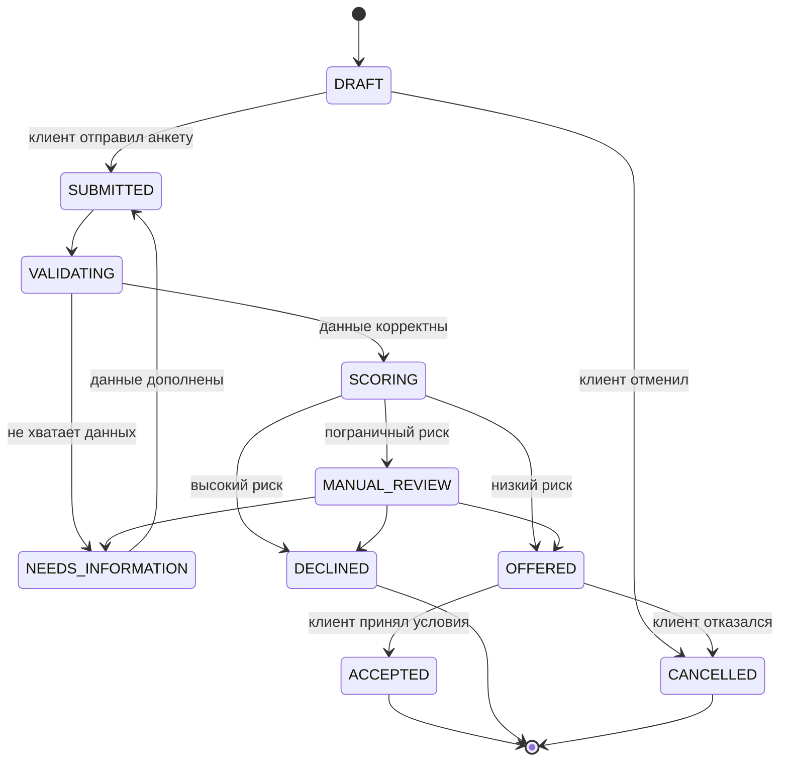

# Состояния кредитной заявки

В первой версии API реализованы основной автоматический путь и принятие оффера. `NEEDS_INFORMATION`, `CANCELLED` и решение андеррайтера зафиксированы в модели, но их UI/API-команды — следующая итерация.

Каждый переход сохраняет `from_status`, `to_status`, `actor`, `reason`, `created_at`.

