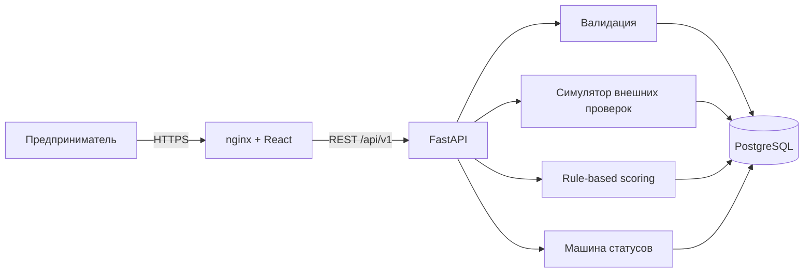

# Архитектура MVP

## Контекст

Целевой пользователь — собственник, руководитель или финансовый сотрудник малого бизнеса. Ему нужен понятный путь без знания внутренней банковской терминологии. Для жюри важны воспроизводимость, автономность и связность модулей.

## Схема

## Почему так

- **Монолит в MVP.** Границы модулей явные, но нет преждевременной сложности микросервисов.
- **PostgreSQL как единый source of truth.** Заявка и каждый переход статуса сохраняются.
- **Синхронный decision engine.** Делает демо быстрым и детерминированным. Промышленная версия вынесет этапы в очередь.
- **Прозрачные правила вместо ML.** Для первого сквозного пути важнее объяснимость и проверяемость.

## Нефункциональные решения

- версии зависимостей и базовых image зафиксированы;
- миграции БД выполняются Alembic до старта API;
- healthcheck координируют порядок старта;
- на границе API есть типизированная валидация;
- в проде нужны secrets manager, TLS, OIDC, RBAC, шифование PII, rate limit, трассировка и резервное копирование.

## Целевое развитие

Следующий шаг — очередь задач, idempotency keys, outbox, воркеры проверок, централизованные logs/metrics/traces и дизастероустойчивая БД. Модульные границы уже позволяют это, не усложняя MVP заранее.

