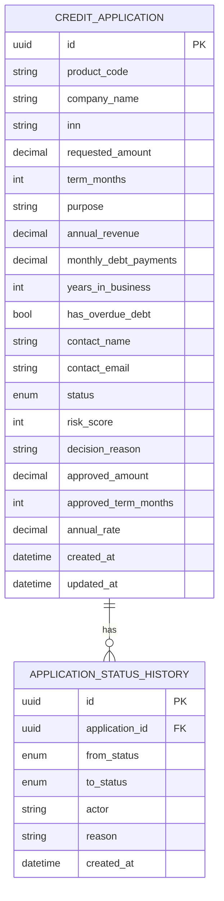

# Модель данных

Денежные поля хранятся как `NUMERIC`, а не float. UUID не раскрывает порядок создания заявок. История статусов append-only на уровне приложения.

Перед продакшеном нужно вынести PII в отдельный защищённый контур, добавить клиента/организацию как самостоятельные сущности и установить сроки хранения.

